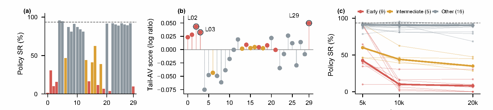
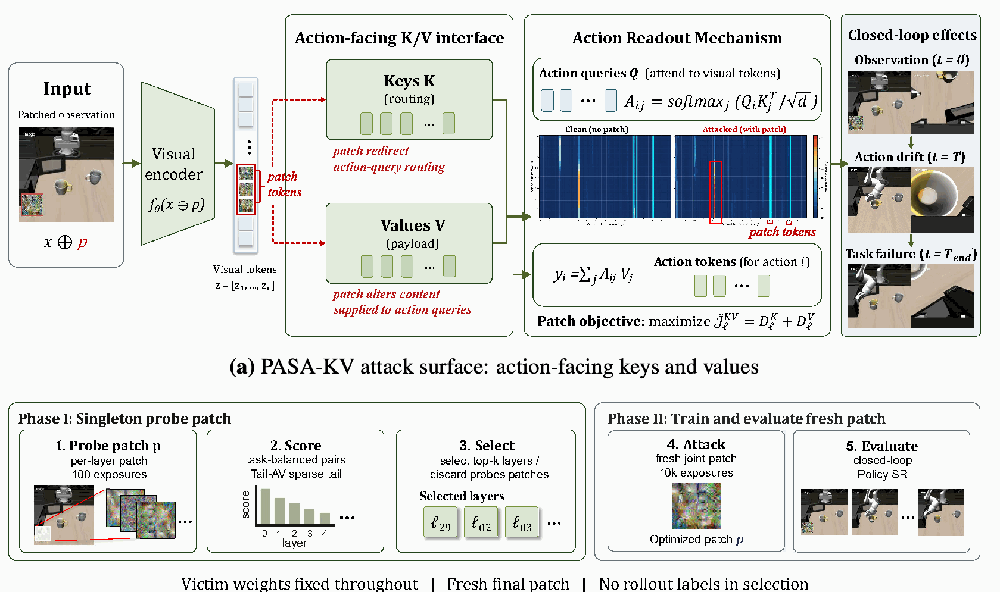
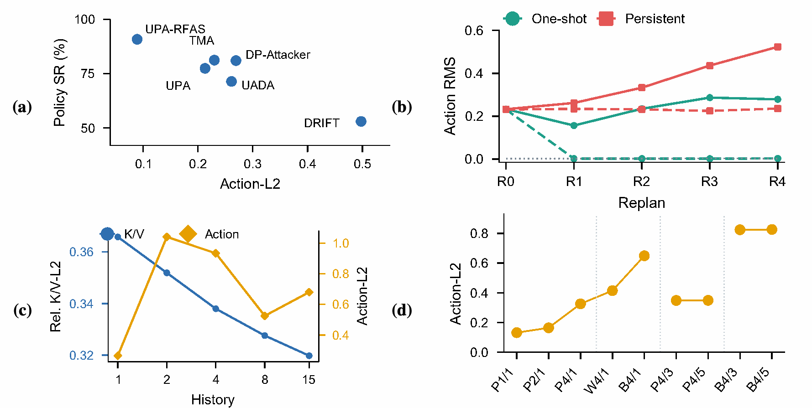
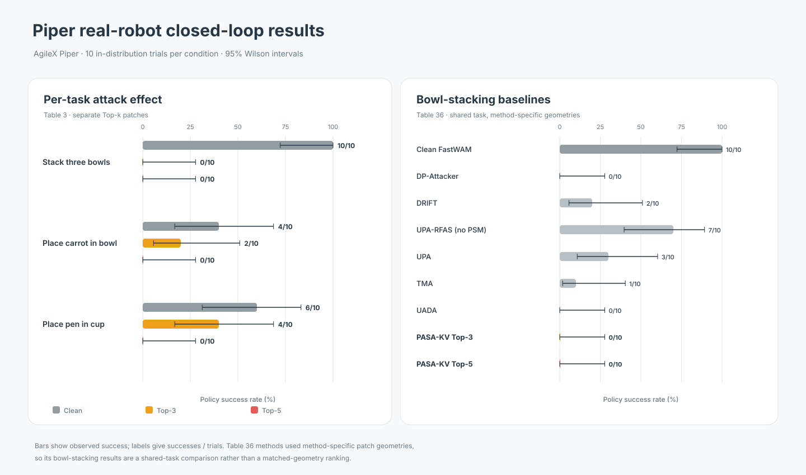

# PASA-KV: Attacking Action-Facing Visual Routes in World Action Models

PASA-KV probes action-facing visual key/value (K/V) routes in world action models, selects vulnerable routes with Tail-AV, and trains a fresh task-shared patch on the selected layers. The figures below are taken from the supplied manuscript PDF so the README follows the paper's current figures and color palette.

## Main-paper figures

<p align="center">
  
</p>
<p align="center"><em>Figure 1 · Layerwise evidence for action-facing vulnerability.</em></p>

<p align="center">
  
</p>
<p align="center"><em>Figure 2 · PASA-KV construction pipeline.</em></p>

<p align="center">
  
</p>
<p align="center"><em>Figure 3 · Action-response diagnostics across models and intervention settings.</em></p>

## Real-robot evaluation

Experiments use an AgileX Piper arm with head and wrist RGB cameras. The scene figure pairs each initial scene with a representative annotated reference-rollout frame; it illustrates task setup and approximate progress, not complete trajectories.

<p align="center">
  
</p>
<p align="center"><em>Real-robot task scenes and representative reference-rollout frames (paper Figure 13).</em></p>

The chart below turns the paper's real-robot result tables into bars. Table 3 shows clean, Top-3, and Top-5 success over three tasks; Table 36 compares methods on bowl stacking. Each condition has 10 trials, and whiskers show 95% Wilson intervals. Table 36 uses method-specific patch geometries, so it is a shared-task comparison rather than a matched-geometry ranking.

<p align="center">
  
</p>

Source tables: [Table 3 data](assets/figures/piper-real-robot/table3_task_results.csv) · [Table 36 data](assets/figures/piper-real-robot/table36_bowl_baselines.csv) · [chart source](assets/figures/piper-real-robot/plot_piper_results.py).

## Code

The anonymous reference implementation is in [`code/PASAKV`](code/PASAKV). Start with its [English README](code/PASAKV/README.md), [Chinese README](code/PASAKV/README_zh.md), and [NOTICE](code/PASAKV/NOTICE.md).

```bash
cd code/PASAKV
python -m pip install -e ".[test]"
```

Model adapters, model weights, datasets, and simulator assets are not included. This repository provides the core method interfaces and CPU-level tests, but is not an end-to-end reproduction environment.

## Paper and release status

The manuscript is under review; a public preprint and citation entry will be added when available. This anonymous method snapshot has no assigned open-source license yet. Review upstream compatibility and figure permissions before a public release.
