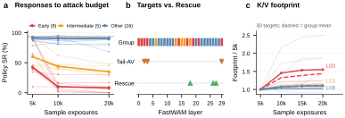
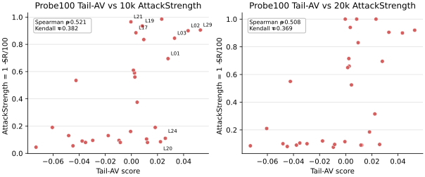
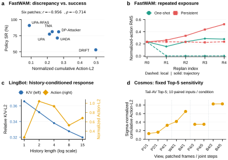
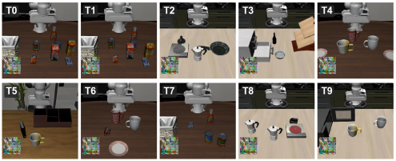
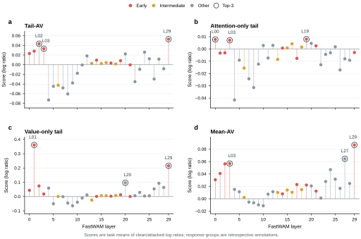
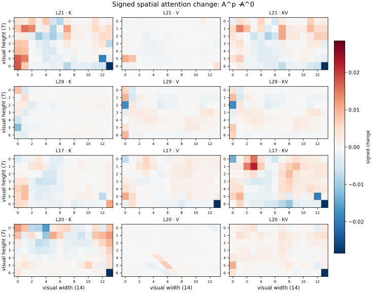
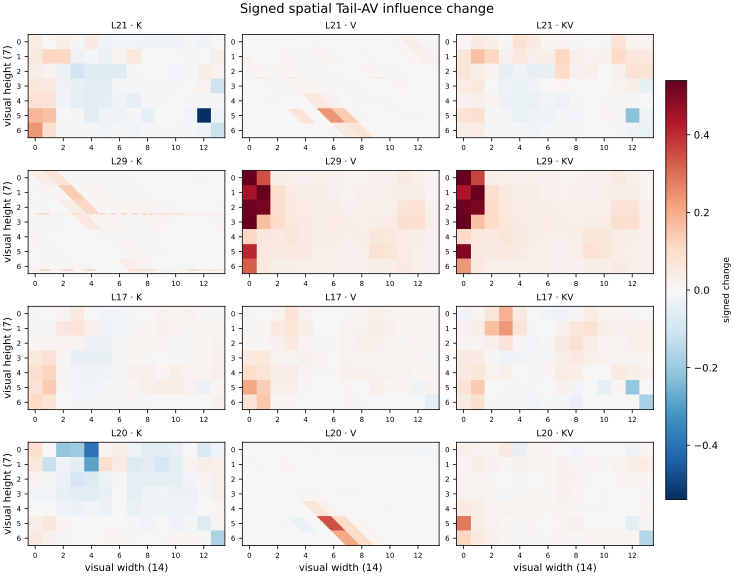
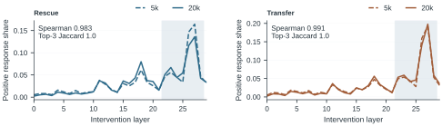

# PASA-KV — Project Overview

  

PASA-KV studies how visual perturbations affect the action-facing key and value (K/V) routes used by world-action models. The project develops a model-agnostic reference implementation for probing candidate routes, ranking them by paired action response, and training a fresh universal patch on selected routes.

## Why this project

World-action models combine visual processing and robot control through different inference graphs. PASA-KV focuses on the internal K/V routes that carry visual information toward action computation, and asks how a limited probing budget can identify routes that matter to downstream actions.

## Method at a glance

1. **Probe candidate routes.** Run short K/V patch probes with a task-balanced schedule.
2. **Rank by action response.** Score paired clean and patched outputs with the Tail-AV selector; online task success is not used for selection.
3. **Train and evaluate.** Select the requested top-k routes, initialize a fresh RGB patch, and evaluate policy success on a separate evaluation grid.

The implementation includes the core scoring and training interfaces, configuration examples, and CPU-level method tests. Model adapters, model weights, datasets, and simulator assets remain external dependencies.

## Figure archive

The figure assets below come from the project archive. SVG vectors are included where available; Figure 4 is a PNG rendering of the pipeline diagram. Review captions and alignment with the latest manuscript before treating them as final public paper figures.

  <figure><figcaption>Figure 1</figcaption></figure>
  <figure><figcaption>Figure 2</figcaption></figure>
  <figure><figcaption>Figure 3</figcaption></figure>
  <figure><figcaption>Figure 5</figcaption></figure>
  <figure><figcaption>Figure 6</figcaption></figure>
  <figure><figcaption>Figure 7</figcaption></figure>
  <figure><figcaption>Figure 8</figcaption></figure>
  <figure><figcaption>Figure 9</figcaption></figure>
  <figure><figcaption>Figure 10</figcaption></figure>
  <figure><figcaption>Figure 11</figcaption></figure>

## Code

The anonymous reference implementation is in the code/PASAKV directory. Start with its English README, Chinese README, and NOTICE.md.

<pre><code>cd code/PASAKV
python -m pip install -e ".[test]"</code></pre>

No end-to-end simulator command is supplied: adapters and upstream model/runtime revisions must be installed and audited separately.

## Paper and citation

Add the verified current preprint and citation entry here after recovering the latest manuscript source. The local migration package contains an earlier editable draft; it is not the submitted version.

## Release status

This is an anonymous method snapshot prepared for review. The staged repository has no assigned license yet. Choose a license and review upstream compatibility before making a public release. Recheck anonymization and figure permissions after adding material.

---

This page is a static GitHub Pages starting point. It has no external runtime dependencies; publish this directory as the site root after reviewing the release checklist.

