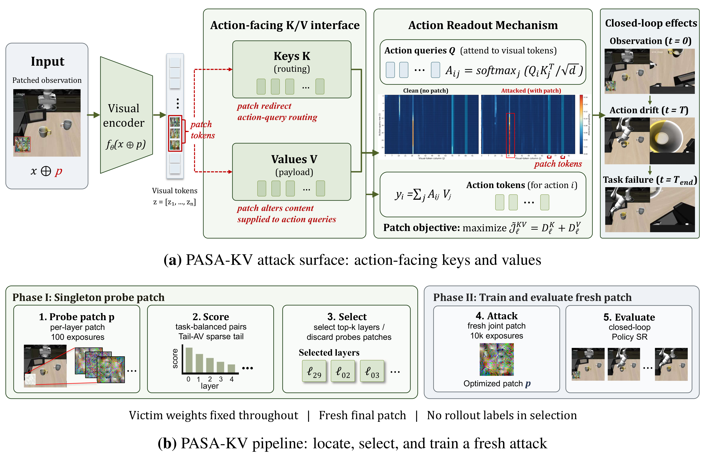
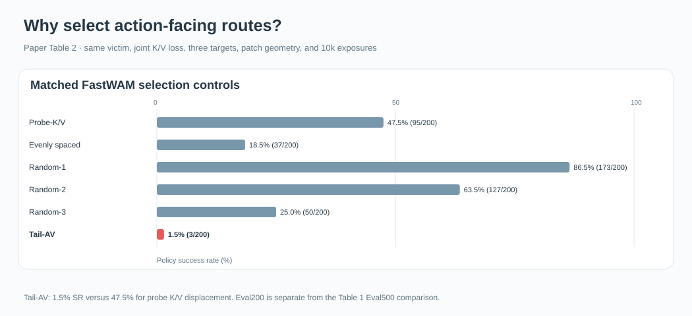
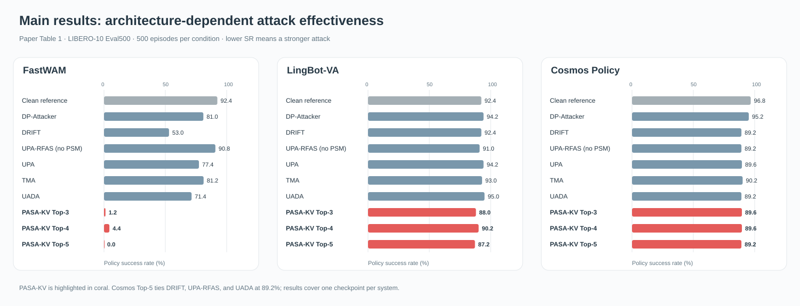
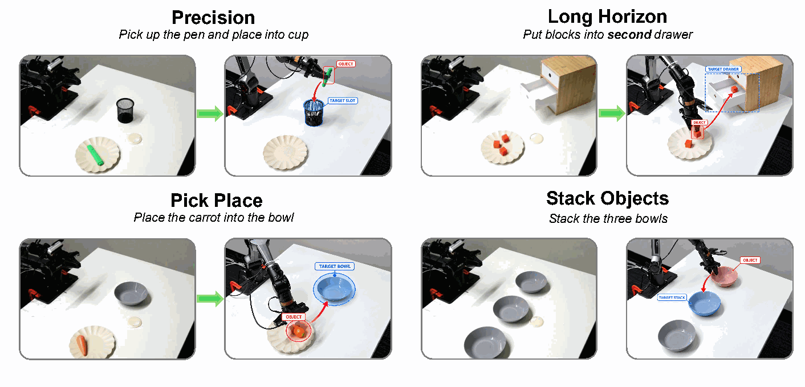
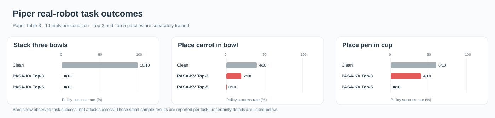

# PASA-KV: Attacking Action-Facing Visual Routes in World Action Models

**Which visual routes matter to robot actions?** PASA-KV uses short probes and the Tail-AV score to locate action-facing key/value (K/V) routes, then trains a fresh task-shared RGB patch against those routes.

Internal representation change, action response, and closed-loop task failure are different quantities. Our experiments show that target-layer choice strongly affects control outcomes, and that short readout-aware probes can identify useful attack targets without using rollout success for selection.

[Method and integration guide](docs/integration.md) · [Full results and diagnostics](docs/results.md) · [Reference code](code/PASAKV) · [中文代码说明](code/PASAKV/README_zh.md)

## How the method works

1. **Probe:** optimize a small RGB patch for each candidate layer using visual K/V displacement.
2. **Select:** score paired clean/patched action-facing readouts with Tail-AV on held-out observations. No rollout success labels enter selection.
3. **Train fresh:** discard probe patches and initialize a new patch for the selected Top-k routes.
4. **Evaluate:** overlay the patch on the current camera observation at every replan and measure closed-loop task success.

<p align="center"></p>

**What is modified?** The optimized object is an RGB patch. Internal K/V tensors provide the training loss; victim weights remain frozen. At deployment, the patch modifies camera pixels. Keys determine where action queries read, and values determine the content they receive. Large K/V displacement alone need not produce a large behavioral effect.

## Why route selection matters

Under matched FastWAM conditions, Tail-AV obtains **1.5% policy success**, versus **47.5%** for selecting layers by probe K/V displacement. These comparisons fix the loss, target count, geometry, and training budget, directly testing the contribution of layer selection.

<p align="center"></p>

[Table 2 source values](assets/figures/readme/table2_selection.csv). This Eval200 comparison is separate from the primary Eval500 results below.

## Main results

Policy success rate (SR) is the robot's task success rate: **lower SR means a stronger attack**. PASA-KV Top-5 reaches 0.0% on FastWAM, 87.2% on LingBot-VA, and 89.2% on Cosmos Policy. The smaller changes on the latter two systems are part of the finding; Cosmos Top-5 ties several baselines.

<p align="center"></p>

| Evaluated system | Action-facing interface | Context for interpreting results |
| --- | --- | --- |
| FastWAM | Direct action generation reads visual K/V | Strong attack effects on the evaluated checkpoint |
| LingBot-VA | Visual prediction precedes action generation through cached K/V | Smaller success degradation under its evaluated protocol |
| Cosmos Policy | Actions and visual states interact in joint denoising | Top-5 ties the lowest observed SR in the comparison |

These are system-level comparisons covering one checkpoint per architecture, with architecture-specific interfaces and settings. They do not establish a causal explanation for the resistance differences. [Recorded GPU-hours, full tables, and diagnostics](docs/results.md) provide additional context.

## Real-robot evaluation

On a separately trained AgileX Piper FastWAM checkpoint, the full probe–select–train procedure was rerun. One patch per Top-k condition was shared across tasks and digitally overlaid on the current head-camera image at each replan; the wrist view remained unchanged.

<p align="center"></p>

These scene pairs illustrate task setup and reference progress. They are not clean-versus-attack demonstrations. The four-task training suite includes a drawer task, but the reported attack comparison covers the three tasks with nonzero clean success.

<p align="center"></p>

Each condition has 10 trials. [Per-task data](assets/figures/piper-real-robot/table3_task_results.csv), [Wilson intervals and bowl-stacking baseline comparison](docs/results.md) are available separately. Baseline coverage is limited to bowl stacking, and its patch geometries differ by method.

## Use the reference implementation

```bash
cd code/PASAKV
python -m pip install -e .
```

The package includes Tail-AV scoring, task-balanced sampling, rectangular patch overlay, Probe100 orchestration, fresh Top-k training, and evaluation-grid checks. Integrating a victim model requires implementing the adapter contract and supplying model/data dependencies.

```python
from examples.run_pipeline import run_pipeline

# adapter and data providers come from your upstream integration.
selected, result = run_pipeline(
    adapter=adapter,
    probe_example_at=probe_example_at,
    scoring_examples_by_task=scoring_manifest,
    final_example_at=final_example_at,
    output_dir="outputs/fastwam_top3",
    top_k=3,
    device="cuda",
)
```

The example saves the ranking, selected layers, sample identifiers, and RGB patch tensor. [Integration guide](docs/integration.md) explains the inputs, pairing requirements, and outputs.

**Reproduction scope:** The included code supports method-level CPU tests and generic Probe100 → Tail-AV → fresh Top-k patch training once a victim-model adapter and sample providers are supplied. The plotted result tables can be regenerated from the included CSV files and scripts. Reproducing the paper’s model and robot experiments also requires the evaluated model implementations/checkpoints, observations, simulator or robot setup, and model-specific adapters and rollout launchers; these are not included here.

## Paper and release status

The manuscript is under review. A public preprint and citation will be added when available. This repository has no assigned open-source license yet.
