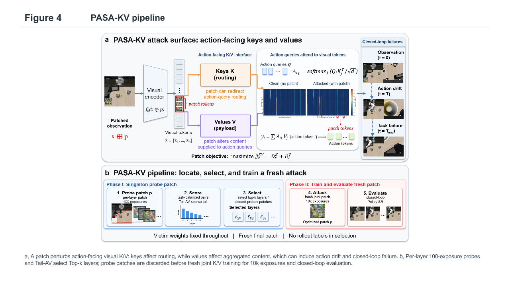
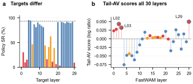
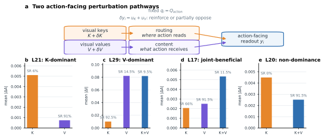
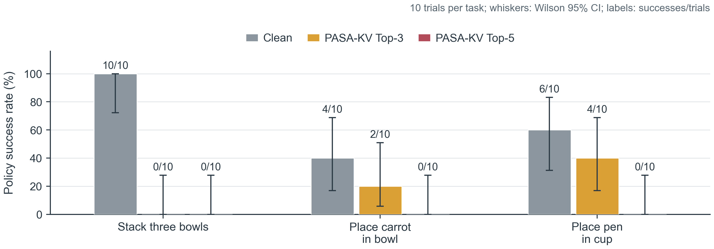

# PASA-KV

**PASA-KV** studies how visual perturbations affect the action-facing key and value (K/V) routes used by world-action models. This repository contains an anonymous reference implementation, selected paper figures, and a static project page.

## Method

PASA-KV probes candidate K/V routes, ranks them by paired action response with the Tail-AV selector, then trains a fresh universal patch on selected routes. Online task success is reserved for evaluation and is not used to select routes.

<p align="center">
  
</p>
<p align="center"><em>Overview of the PASA-KV pipeline.</em></p>

## Main results

The paper figures below highlight the two findings that motivate the method: target layers differ substantially in policy success under the same attack budget, and action-facing K/V pathways vary by layer and intervention type.

<p align="center">
  
</p>
<p align="center"><em>Target layers have different policy success rates; Tail-AV scores all 30 layers and identifies candidate targets.</em></p>

<p align="center">
  
</p>
<p align="center"><em>Key and value interventions affect action routing and content differently across layers.</em></p>

## Real-robot results

On the AgileX Piper arm, the project evaluated three tabletop tasks with 10 trials per task. The chart shows per-task success for clean observations and patches trained on the selected Top-3 or Top-5 routes. Each trial is shown in the labels; whiskers indicate 95% Wilson intervals.

<p align="center">
  
</p>
<p align="center"><em>Per-task real-robot success rate. These are small-sample results (10 trials per task), not a pooled estimate across tasks.</em></p>

Source data: [`piper_success_source.csv`](assets/figures/real-world/piper_success_source.csv) · [vector chart](assets/figures/real-world/piper_success.svg) · [success rates and Wilson intervals](assets/figures/real-world/piper_success_with_wilson_ci.csv).

## Code

The anonymous reference implementation is in [`code/PASAKV`](code/PASAKV). Start with its [English README](code/PASAKV/README.md), [Chinese README](code/PASAKV/README_zh.md), and [NOTICE](code/PASAKV/NOTICE.md).

```bash
cd code/PASAKV
python -m pip install -e ".[test]"
```

Model adapters, model weights, datasets, and simulator assets are not included. The package provides the core method interfaces and CPU-level tests, but is not an end-to-end reproduction environment.

## Project page and citation

- Static project page: [`index.html`](index.html)
- Paper and citation: to be added after the current manuscript and public preprint are verified.

## Release status

This is an anonymous method snapshot. No open-source license has been assigned yet. Review the upstream compatibility and figure permissions before making a public release.
