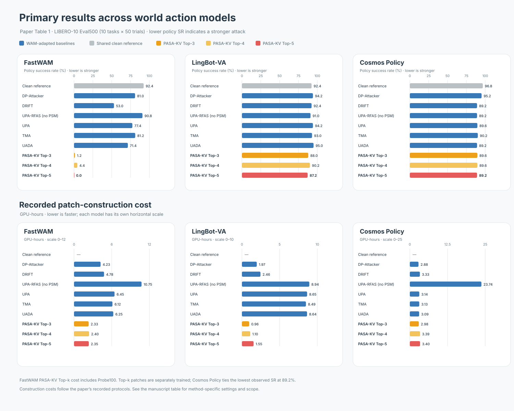
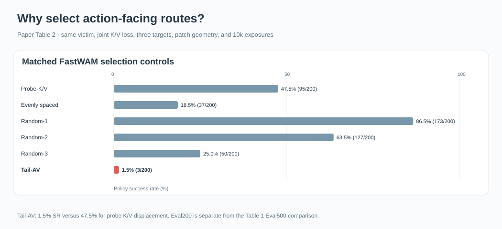
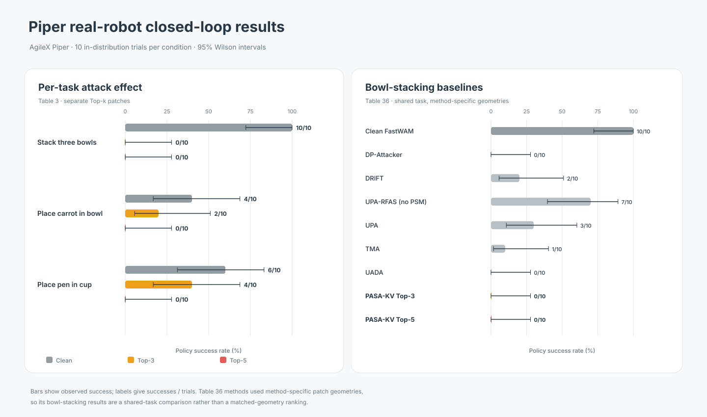

# Full results and diagnostics

These assets follow the supplied manuscript, *PASA-KV: Attacking Action-Facing Visual Routes in World Action Models*. The charts below use the same grey, grey-blue, and coral palette as the README. Original manuscript figures remain linked for the detailed diagnostics.

## Primary comparisons and construction costs

[Table 1 data](../assets/figures/paper-main-results/table1_results.csv) · [generation script](../assets/figures/paper-main-results/plot_table1.py).

Policy SR is task success, so lower is a stronger attack. GPU-hours are recorded construction costs, not policy latency. Cost panels use different horizontal scales. FastWAM Top-k includes Probe100. On Cosmos, DP-Attacker costs 2.88 GPU-h versus 2.98 for PASA-KV Top-3; PASA-KV is not uniformly cheaper across systems. Each Top-k patch is trained separately.

## Layerwise evidence

The matched selection controls compare routes selected using action readouts with probe K/V displacement and other controls. [Original manuscript Figure 1](../assets/figures/paper-2026-09/fig1_layerwise.png) shows the full layerwise probe and rollout diagnostics, including the retrospective response groups. Those groups are not selector inputs.

## Action-response diagnostics

[Original manuscript Figure 3](../assets/figures/paper-2026-09/fig3_diagnostics.png) contains four diagnostic panels with different protocols: (a) action discrepancy versus task success across six FastWAM baseline patches; (b) one-shot versus persistent patch exposure; (c) LingBot history-conditioned responses; (d) Cosmos input extent and joint solver steps. Action discrepancy provides diagnostic evidence but does not replace closed-loop evaluation. The paper discusses protocol details in Appendices C.1 and D.3–D.5.

## Piper real-robot outcomes

[Table 3 data](../assets/figures/piper-real-robot/table3_task_results.csv) · [Table 36 data](../assets/figures/piper-real-robot/table36_bowl_baselines.csv) · [generation script](../assets/figures/piper-real-robot/plot_piper_results.py).

Wilson 95% intervals are calculated for the website from the reported success counts. They show the uncertainty of 10-trial conditions and were not reported in the original tables. Baseline results cover bowl stacking only and use method-specific patch geometries. Top-4 was not physically evaluated. The drawer task had 0/10 clean success and no attack comparison.

## Scope

Cross-model results cover implemented WAM adaptations and one checkpoint per architecture. They support conclusions about the evaluated systems and settings. The scene pairs are representative reference frames, not complete trajectories or evidence of clean-versus-patched outcomes. A verified paired demonstration can be added with its run manifest and deployment conditions when prepared.
